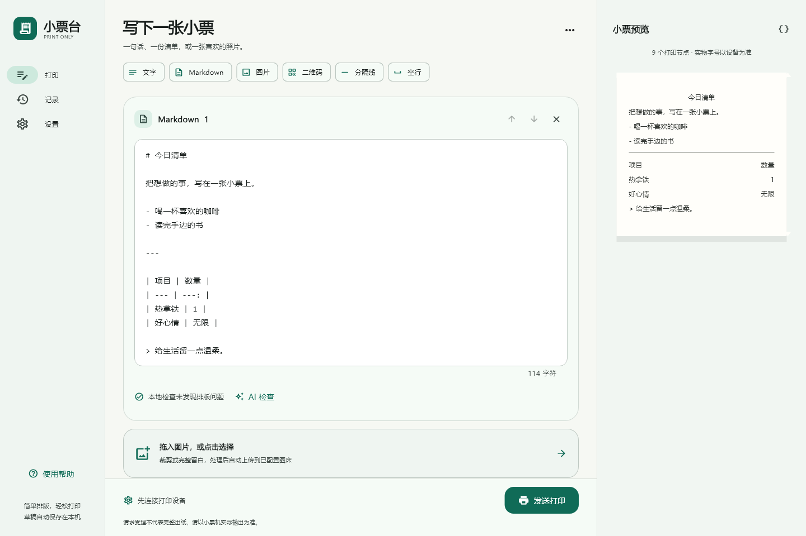
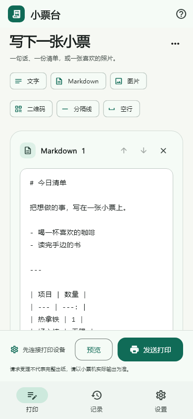

# 小票台 · Print Only

Android 与 Windows 的纯打印客户端，使用 **Flutter + Material Design 3**。本分支仅保留手动排版、预览、图片处理与打印，不包含 QQ / Telegram 消息监听。

- 分支：`feature/print-only-material`
- Android：底部导航、单列编辑、弹层小票预览。
- Windows：侧边导航、编辑 / 纸面预览双栏，支持窄窗口。
- 两端独立运行，无需 Node.js、电脑服务或 FFmpeg。

## 界面预览

Windows：



Android：



## 功能

- 普通文字、自动识别 Markdown、表格、清单、代码与引用。
- 图片选择 / Windows 拖拽；方形裁剪或等比例白底留白；亮度、对比度、黑白抖动。
- 短二维码、固定 divider 分隔线和空白行；内容块可排序。
- Cloudflare R2、S3 兼容签名上传、自定义 HTTP 图床；默认图片前缀为 `xiaopiao`。
- 可选 OpenAI 兼容 AI 检查，默认关闭，建议需预览后手动应用。
- 自动保存草稿、文档导入 / 导出、本机打印记录、浅色 / 深色主题。
- 设备 / 图床 / AI 凭据使用系统安全存储，可导入 SID 助手或旧版配置 JSON。

## 开始使用

1. 打开设置，导入设备 JSON 或填写实际 `device_sn`、`sid` 和 `account_type`。
2. 需要图片时配置图床。R2 的 Region 填 `auto`，公开地址填写图片域名，前缀可填 `xiaopiao`。
3. 使用“上传测试图片”检查上传与公开下载，该操作不会打印。
4. 编辑或导入内容，查看预览，再点击“发送打印”。

[协议与图片实测说明](docs/PRINTAD-PROTOCOL.md) · [两端设计与实现](docs/PRINT-ONLY-DESIGN.md)

设备 SID 有有效期，失效后需要重新获取。接口返回成功只代表请求受理，出纸与完整性以实物为准。

## 图片与二维码

设备会将原始长图压成固定方形。本应用会先做方形裁剪或保持比例填入白底，再转换为不透明 PNG，避免设备拉伸与透明区变黑。支持 PNG/JPEG/WebP/GIF 导入，交给设备的最终格式为 PNG。

图片导入 / 下载上限 20 MiB，解码内存保护为 4000 万像素，输出 280×280；这些都是本地策略，不是测得的硬件上限。当前没有长图自动切片或无缝拼接功能。

长内容原生二维码存在实测设备重启风险。本应用在统一发送入口检查 100 UTF-8 字节，不静默截断。该值是保守策略，不构成对所有固件的安全保证。

## 配置与图床

R2 使用限于目标桶的对象读写 Access Key ID / Secret Access Key，Session Token 仅在临时 S3 凭据需要时填写。Cloudflare 管理 API 令牌不填入 Session Token。

公开域名必须允许小票机无 Cookie / 登录访问。S3 Endpoint 与公开域名分别填写；对象按 `xiaopiao/年/月/日/内容哈希.png` 命名。Android 和 Windows 直接签名上传，不需要浏览器 CORS 设置。

自定义 HTTP 图床使用 multipart POST，可配置上传地址、文件字段名、Authorization 和返回 URL 路径（例如 `data.url` 或 `0.url`）。

导入旧版 `config.json` 只迁移设备、图床和 AI 配置，消息机器人设置不会迁移。导出的小票文档不包含配置对象；本机草稿包含用户正文与处理后的图片，请按需管理。

## 构建

开发环境使用 Flutter **3.41.5**、Dart **3.11.3**。Android 最低 API 24；Windows 需要 Visual Studio 的 C++ 桌面开发工具链。

```sh
flutter pub get --enforce-lockfile
flutter analyze
flutter test
flutter build apk --release --split-per-abi
flutter build windows --release
```

CI 工作流为 `.github/workflows/print-only.yml`，产出 Android APK 和 Windows x64 Release 文件。Android 当前为开发测试签名预览版；正式发布需配置自己的持久签名。Windows 包需要完整解压后运行 `xiaopiao.exe`。

全部网络测试使用模拟接口，不会触发实物打印或向真实图床 / AI 发送测试内容。原生设备上的最终效果需要使用自己的参数确认。

生成离屏设计预览（Windows 安装字体环境）：

```powershell
$env:GENERATE_PREVIEWS = '1'
flutter test test/app_widget_test.dart
```

## 快捷键

Windows 支持 Ctrl+Enter 发送、Ctrl+O 导入、Ctrl+S 导出。图片与 Markdown / 文本文档可以拖入编辑区。

## 来源与许可

本项目基于 [lemonno2333/WeChat-Printer](https://github.com/lemonno2333/WeChat-Printer) 的协议研究与应用方向，沿用 [MIT License](LICENSE)。本分支以 Dart / Flutter 重新实现纯打印客户端；Flutter 与各依赖保留其自身许可证，可在系统设置的许可页面或依赖包中查阅。
